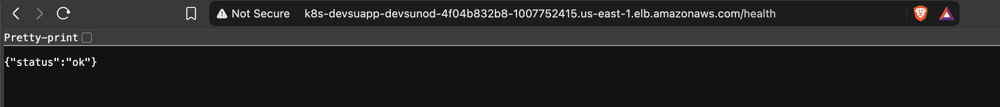
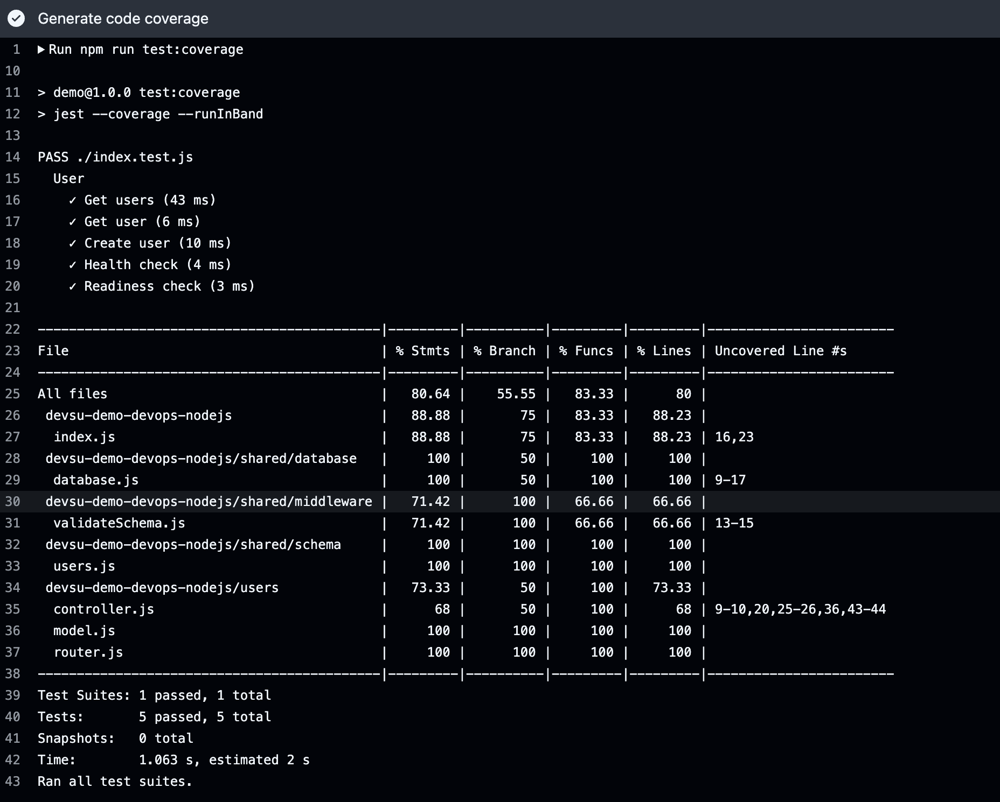
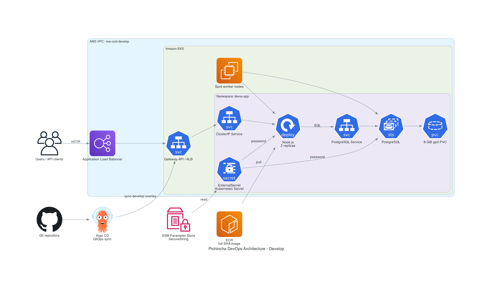
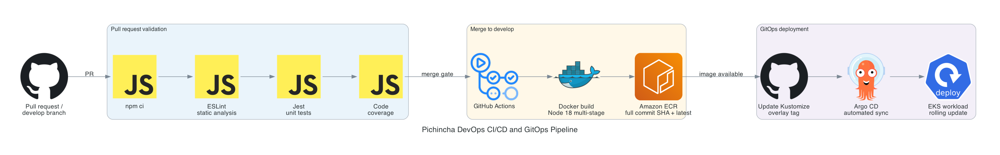
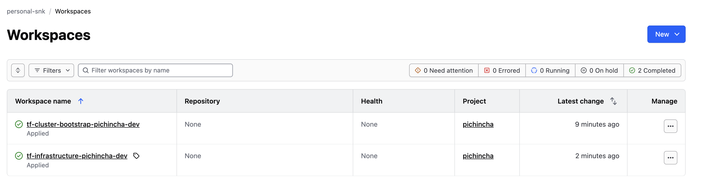
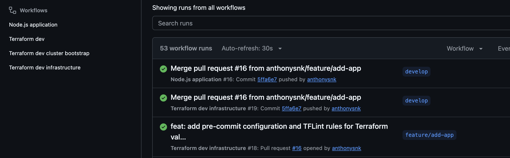

# DevOps exercise: infrastructure foundation

Covers the Node.js starter, its container,
the GitHub Actions pipeline, the Terraform infrastructure and the Kubernetes
deployment delivered through Argo CD.

## Public deployment

The `develop` environment runs on EKS and is reachable through the internet-facing
ALB provisioned by the Gateway API resources:

```text
http://k8s-devsuapp-devsunod-4f04b832b8-1007752415.us-east-1.elb.amazonaws.com
```

| Path         | Expected | Purpose                                      |
| ------------ | -------- | -------------------------------------------- |
| `/health`    | `200`    | Liveness probe                               |
| `/ready`     | `200`    | Readiness probe; `503` until the DB connects |
| `/api/users` | `200`    | Users API                                    |

```bash
export ALB_URL="http://k8s-devsuapp-devsunod-4f04b832b8-1007752415.us-east-1.elb.amazonaws.com"
curl -i "$ALB_URL/health"
curl -i "$ALB_URL/ready"
curl -s "$ALB_URL/api/users"
```

`GET /` returns `404` with `Cannot GET /`. That is the starter's default handler,
not a routing failure: the request already crossed the ALB, the Gateway and the
Service to reach the process. Use `/health`, `/ready` or `/api/users` to validate
the deployment.



The endpoint is HTTP on port 80 only; TLS requires a domain and is documented
under [DNS and TLS](#dns-and-tls).

## Local development

Run the application and its checks exactly as the pipeline does, inside
`devsu-demo-devops-nodejs`. Node.js 18.15.0 is the version the container image and
the pipeline use.

```bash
cd devsu-demo-devops-nodejs
npm ci
npm run lint
npm test
npm run test:coverage
npm start
```

`npm start` listens on `http://localhost:8000` and, without further configuration,
uses SQLite in `dev.sqlite`. That file is ignored by Git and is convenient only for
local runs: it is not shared and not durable, which is why the cluster uses
PostgreSQL. To point the application at a local PostgreSQL:

```bash
DATABASE_DIALECT=postgres \
DATABASE_HOST=127.0.0.1 \
DATABASE_PORT=5432 \
DATABASE_NAME=devsu \
DATABASE_USER=devsu \
DATABASE_PASSWORD=devsu \
npm start
```

Build and run the container the same way the pipeline does. The Dockerfile runs
`npm test` inside the build stage, so a failing test stops the image from being
produced:

```bash
cd devsu-demo-devops-nodejs
docker build -t devsu-nodejs:local .
docker run --rm -p 8000:8000 devsu-nodejs:local
curl -i http://127.0.0.1:8000/health
```



## Cluster access

Requires AWS CLI v2, kubectl, the configured SSO profile, EKS access for its
role, and network access to the cluster API.

```bash
export AWS_PROFILE="050264659180_AdministratorAccess"
export AWS_REGION="us-east-1"
CLUSTER_NAME="dev-pichincha-dev-eks"

aws sso login --profile "$AWS_PROFILE"
aws eks update-kubeconfig \
  --name "$CLUSTER_NAME" \
  --region "$AWS_REGION" \
  --profile "$AWS_PROFILE"

kubectl config current-context
kubectl get nodes
```

`update-kubeconfig` changes your local context. Confirm it before continuing.

## Argo CD

Requires Argo CD installed in `argocd`. Initial password on macOS:

```bash
kubectl -n argocd get secret argocd-initial-admin-secret \
  -o jsonpath='{.data.password}' | base64 -D
printf '\n'
```

Sign in as `admin` and change the initial password. If the secret was removed,
use the current password. Forward directly to the server deployment:

```bash
kubectl -n argocd port-forward deployment/argocd-server 8080:8080 --address 127.0.0.1
```

Open **https://localhost:8080**. The default certificate is self-signed.
Keep the terminal open; Ctrl+C stops forwarding. Only localhost is exposed.

## Application Kubernetes resources

The application resources use Kustomize:

```text
kubernetes/
├── application/
│   ├── base/
│   │   ├── ConfigMap, Deployment, Service, HPA
│   │   ├── Gateway, HTTPRoute
│   │   └── kustomization.yaml
│   └── overlays/
│       └── develop/
│           ├── kustomization.yaml
│           ├── SecretStore, ExternalSecret
│           └── environment-specific values
└── argocd/
    └── develop/
        └── application.yaml
```

The application starts with two replicas, exposes `/health` for liveness and
`/ready` for database readiness, and uses the `alb` GatewayClass managed by the
AWS Load Balancer Controller. Develop uses a single PostgreSQL StatefulSet
with an 8 GiB `gp3` PVC; this is a low-cost demonstration topology, not a
production database service. Terraform generates the database password using
the parameter convention
`/<project_name>/<environment>/application/database-password`, stores it as
an SSM Parameter Store `SecureString`, and the environment overlay references
that parameter through External Secrets Operator. The password is not
committed to Git.

The current Gateway exposes HTTP on port 80 because the application domain and
ACM certificate are not configured yet. The Gateway and HTTPRoute manifests
include commented HTTPS listener and HTTP-to-HTTPS redirect examples for the
future ACM/TLS configuration.

Create the develop Argo CD `Application` once after Argo CD is available:

```bash
kubectl apply -f kubernetes/argocd/develop/application.yaml
```

The resource is named `devsu-nodejs-develop`, targets the `develop` branch and
watches
`kubernetes/application/overlays/develop` on the `develop` branch. GitHub
Actions updates the image name and full commit SHA tag in that environment's
`kustomization.yaml`; Argo CD performs the synchronization.

## Architecture diagrams

### Runtime architecture



This diagram shows the request path from users through the ALB, Gateway API,
Node.js application, PostgreSQL StatefulSet and encrypted gp3 storage. It also
shows ECR, SSM Parameter Store, External Secrets and Argo CD.

### CI/CD and GitOps pipeline



This diagram shows the pull request quality gates, merge-only image publication
to ECR, Kustomize image-tag update and Argo CD synchronization into EKS.

## Design decisions

Each decision records the alternative that was rejected and why, so the
trade-offs are visible without reading the whole repository.

### Application

- **Node.js starter instead of Java or Python.** The choice is not technically
  significant and no selection criteria were applied: all three starters ship the
  same application with the same tests in a different language, and all three are
  familiar. One had to be picked, so one was picked and the effort went to what is
  actually evaluated: the container, the pipeline, the infrastructure and the
  Kubernetes deployment.
- **`node:18.15.0-bullseye-slim` as the base image.** The starter documents Node
  18.15.0, so the image matches the exact version the tests run against. Debian
  slim keeps `glibc` and the usual native build path; Alpine would introduce
  `musl`, a different dependency build surface and a different class of runtime
  failures for no measurable gain in this image size.
- **Multi-stage build that runs the test suite in the build stage.** A failing
  test stops the image from existing, and the runtime stage keeps only production
  dependencies. The container runs as the unprivileged `node` user, declares its
  port and ships a healthcheck that queries `/health`.

### Cloud and containers

- **AWS `us-east-1`.** The AWS account and its SSO access were already available,
  so no account, billing or quota setup was needed to start.
- **Real EKS instead of minikube or Docker Desktop.** The assignment allows a
  local cluster, but the deployment needed a publicly reachable endpoint so it can
  actually be validated from outside, and managed features are part of what is
  being evaluated: EKS Pod Identity, the AWS Load Balancer Controller and the EBS
  CSI driver do not exist in a local cluster.
- **Cost-first topology, deliberately not production-shaped.** Public subnets for
  the workers, Spot instances, NAT disabled, one small database volume and no
  managed services. The trade-off is explicit: worker nodes have public IPs and
  the EKS API endpoint is public. The production variant is private workers, a NAT
  gateway or VPC endpoints, a restricted API endpoint and a managed database. It is
  documented instead of implemented because the exercise does not need it and it
  multiplies the hourly cost.

### Terraform roots and state

- **Two roots, `infrastructure` and `cluster-bootstrap`.** They have different
  lifecycles and different blast radii. Recreating or destroying the cluster
  controllers must not be able to touch the VPC or the EKS control plane, and each
  root gets its own plan, its own state and its own approval.
- **HCP Terraform as the remote backend.** It supplies remote state, state locking
  and an auditable plan per run, and it is the workflow most companies already
  operate. An S3 backend with DynamoDB/s3 locking is a valid alternative and the one
  I use by default; it was rejected here only because the exercise was meant to
  exercise the hosted workflow end to end. State never lives in the repository.
- **The bootstrap root reads the infrastructure state** through
  `terraform_remote_state` instead of duplicating cluster attributes as variables.
  There is one source of truth for the cluster name, endpoint and certificate
  authority.

### Kubernetes

- **Kustomize for the application, Helm for platform components.** The application
  is a single workload with an environment overlay, so a chart would add templating
  with no benefit. Managed controllers publish charts and must not be
  reimplemented by hand.
- **Gateway API with the AWS Load Balancer Controller, not Ingress with NGINX.**
  The cluster runs on AWS and needs an internet-facing ALB. An NGINX Ingress
  controller would add a second hop and still require an NLB in front of it. The
  AWS controller provisions the ALB directly and implements the standard Gateway
  API, so routes are portable and no vendor resource is embedded in the manifests.
- **PostgreSQL as a StatefulSet with a `gp3` PVC, not RDS.** The starter persisted
  to a local file: not shared, not durable, and impossible to keep consistent
  across two replicas, so a real database had to be added. RDS is the right
  production answer, but it adds a fixed monthly cost to a short-lived exercise.
  The StatefulSet demonstrates persistent storage, a headless Service, a
  `WaitForFirstConsumer` StorageClass and the EBS CSI driver at a fraction of the
  price.
- **Secrets never enter Git.** Terraform generates the database password with
  `random_password` and stores it as an SSM `SecureString`; the External Secrets
  Operator projects it into the namespace through a `SecretStore` and an
  `ExternalSecret`. The alternative, a committed Kubernetes `Secret`, was rejected
  outright.

### Delivery

- **Argo CD owns deployment; CI never runs `kubectl apply`.** Continuous
  integration produces an artifact and a Git change; the cluster converges from
  Git. Cluster state stays reproducible, the diff is reviewable and there is no
  privileged credential in the pipeline that can mutate the cluster directly.
- **Images are tagged with the full commit SHA.** A short SHA can collide and is
  not always resolvable back to a commit. `latest` is published as well for manual
  testing, but every manifest references the immutable tag.
- **The image update arrives as a pull request, not a direct push.** `develop` is
  protected and the repository is public, so every change needs a reviewer. The
  automation branch and its pull request are the approval gate before Argo CD
  synchronizes; auto-merge was rejected because it would bypass that review.
- **One workflow with a path filter, not a second workflow or manual SHA diffing.**
  Whether the application source changed is what decides if an image must be
  built. Merging only a Kustomize tag update therefore runs the quality checks and
  skips publication, without sentinel commits, `[skip ci]` tricks or event-payload
  comparisons.
- **ECR scans on push.** It is the cheapest available vulnerability check and
  needs no extra credential or step. A pipeline scanner such as Trivy is the next
  step, not a requirement of the exercise.

### DNS and TLS

- **No ExternalDNS; the DNS record will be created manually.** No domain of my own
  is available to test against, so automation would have nothing real to manage and
  would create records for a hostname that does not resolve. Route 53 is the
  intended provider and the record is a single alias to the ALB hostname.
- **No cert-manager; TLS will terminate at the ALB with an ACM certificate.** ACM
  certificates are free, renew automatically and are the native option for an ALB.
  cert-manager would add another controller and another certificate lifecycle for
  no gain in this architecture.
- **HTTP on port 80 is active, and TLS is documented instead of configured.** The
  blocker is the missing domain, not the implementation, so the procedure is kept
  next to the manifests instead of being re-derived later: issue an ACM certificate
  for the application hostname, create a Route 53 alias record to the ALB, enable
  the commented `https` listener in
  `kubernetes/application/base/gateway.yaml` with its certificate ARN annotation,
  switch `parentRefs.sectionName` to `https` in
  `kubernetes/application/base/httproute.yaml`, and enable the commented
  `devsu-nodejs-http-redirect` HTTPRoute that redirects port 80 to 443.

## Terraform

| Root                          | HCP workspace                        | Purpose             |
| ----------------------------- | ------------------------------------ | ------------------- |
| `terraform/infrastructure`    | `tf-infrastructure-pichincha-dev`    | VPC, EKS and ECR    |
| `terraform/cluster-bootstrap` | `tf-cluster-bootstrap-pichincha-dev` | Cluster controllers |

Apply infrastructure before bootstrap. Each root uses its own
`environments/develop.tfbackend`; never share or migrate state without review.
Configure inputs in HCP Terraform: `develop.tfvars` is not loaded by CI.
See [bootstrap setup](terraform/cluster-bootstrap/README.md).



Each root has its own workspace, its own state and its own run history. The
bootstrap workspace reads the infrastructure outputs through
`terraform_remote_state`, so the cluster name is never duplicated by hand.

## Pipelines

- [Infrastructure](.github/workflows/dev-infra.yml): infrastructure paths only.
- [Bootstrap](.github/workflows/dev-cluster-bootstrap.yml): bootstrap paths only.
- [Application](.github/workflows/dev-app.yml): Node.js quality checks,
  merge-only image publication and GitOps pull request.

Both target `develop`: PR runs format + plan; push runs format + apply.
Each also watches its own workflow file. Closed PRs do not trigger runs.
Set `TF_API_TOKEN` with plan/apply access in the GitHub environment. Optional
`TERRAFORM_VERSION` must match HCP. Fork PRs do not receive repository secrets.

The application pipeline runs `npm ci`, ESLint, unit tests and coverage on pull
requests and pushes. Only a push to `develop` after a merge builds the
multi-stage image and publishes an immutable full-commit-tagged image plus the
`latest` tag to ECR using GitHub OIDC. When
`kubernetes/application/overlays/develop/kustomization.yaml` exists,
the pipeline updates its image name and full commit SHA tag in an automation
branch and opens a GitOps pull request. After that pull request is merged,
Argo CD detects the Git change and performs the cluster deployment.



Configure these GitHub environment variables for the application workflow:

- `AWS_ROLE_ARN`: IAM role trusted by GitHub OIDC, with ECR push permissions.
- `AWS_REGION`: optional; defaults to `us-east-1`.
- `ECR_REPOSITORY`: optional; defaults to `dev-pichincha-dev-app`.
- `EKS_CLUSTER_NAME`: optional; defaults to `dev-pichincha-dev-eks`.

`AWS_ROLE_ARN` must be configured as a variable in each GitHub environment used
by the workflow. The job resolves the environment dynamically from the base
branch for pull requests or the pushed branch for merges. It is an ARN, not a
secret; each role trust policy must restrict the repository and its branch or
environment subject.

The application workflow does not add another AWS secret. `TF_API_TOKEN`
continues to be used only by the HCP Terraform workflows.

Direct pushes also apply; protect the branch and only allow trusted PRs.
Apply creates a fresh plan, not the speculative PR plan. Review it before
deployment. AWS resources incur costs; restrict EKS access and public node exposure.
Remove bootstrap resources before destroying infrastructure. SSO role access
applies to everyone who can assume the role, not just one session.

## Limitations

Each item below is a deliberate boundary of the exercise, with the reason and the
production alternative. None of them is an unfinished task.

- **No domain and no TLS.** No domain of my own is available to test against, so
  the Gateway serves HTTP on port 80 and TLS is not configured. The procedure to
  enable ACM, Route 53 and HTTPS is written next to the manifests that apply it;
  see [DNS and TLS](#dns-and-tls).
- **The database is a demonstration topology.** A single PostgreSQL StatefulSet
  with one 8 GiB `gp3` volume has no replication, no failover, no automated backup
  and no point-in-time recovery. It exists because the starter persisted to a local
  file, which two replicas cannot share. RDS or Aurora is the production answer.
- **The cluster runs in a single availability zone.** The worker node group is
  pinned to `us-east-1b` because an EBS volume cannot be attached outside its
  zone. With one node and three subnets, a Spot replacement could land in another
  zone and leave the database volume permanently unreachable. Spreading workers
  across zones would require a managed database or a per-zone node group.
- **Workers are public and interruptible.** Public subnets, NAT disabled, a public
  EKS API endpoint and Spot instances are cost decisions. Spot capacity can be
  reclaimed and the nodes have public IPs. Private workers with a NAT gateway or
  VPC endpoints, a restricted API endpoint and IAM-restricted access are the
  production shape; the trade-off is documented under
  [Cloud and containers](#cloud-and-containers).
- **The image update needs a human merge.** `develop` is protected and the
  repository is public, so the automation pull request requires a reviewer before
  Argo CD can deploy it. That merge is the approval gate, not a missing
  automation step.
- **Testing stops at the application and the manifest level.** The suite covers the
  HTTP handlers, the health and readiness endpoints and the request validation; it
  does not run end-to-end against a live cluster, and there is no load test.
- **Vulnerability scanning is ECR-native only.** `scan_on_push` is enabled on the
  repository, but no scanner in the pipeline fails a build on findings.
- **No production hardening.** Two replicas, an HPA between two and five pods, no
  `PodDisruptionBudget`, no `NetworkPolicy`, no observability stack beyond Metrics
  Server, and no backup or restore procedure. The cluster is billable per hour and
  should be destroyed when it is no longer needed.
